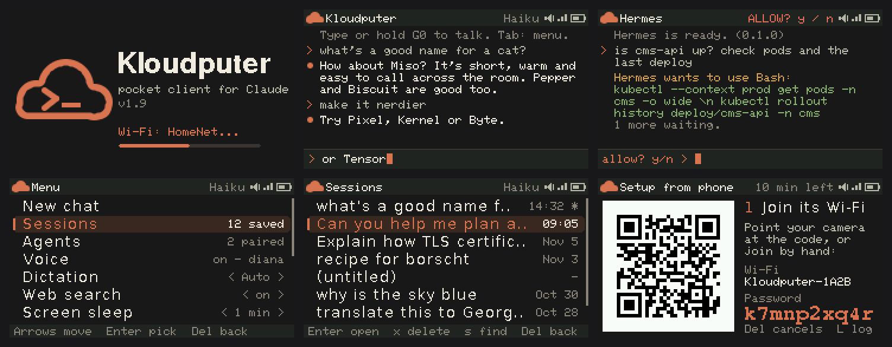

# Kloudputer

An unofficial pocket client for Claude on the **M5Stack Cardputer ADV**. Type or talk to Claude, hear the answer
from the speaker, and pick up saved conversations later. Everything runs on the device itself, with your own API key.

> Kloudputer is an independent open-source project. It is not affiliated with, endorsed by, or sponsored by
> Anthropic. Claude is a trademark of Anthropic, PBC.



*The screens above are drawn by the firmware's own UI code (`tests/ui/preview.sh`), at twice their 240x135 size.*

## What it does

- **Chat with Claude.** The model can be Haiku, Sonnet, Opus or Fable, switched from the menu.
- **Replies appear as they are written.** The answer streams onto the screen instead of arriving all at once.
- **Voice in.** Hold G0, speak, and release. The speech is transcribed by Groq's Whisper or by Google Gemini.
- **Voice out.** Answers are read aloud, with six voices to choose from.
- **Talk mode.** Tap G0 twice for a hands-free conversation: it listens, answers aloud, and listens again. Any key or
  saying "stop" ends it.
- **Two voice providers.** Set a Groq key, a Gemini key, or both. With both, the menu's *Voice via* row picks who goes
  first, and the other steps in when the first is rate limited or refuses.
- **Saved conversations.** Every chat is saved to the SD card, so you can resume or delete it later.
- **Web search.** Claude can look up current facts when a question needs them (on by default, switch it in the menu).
  Your Anthropic organization must allow web search, or Kloudputer turns it off for the session.
- **Cost estimate.** The menu shows what your chats cost today, this chat and in total, from list prices and token counts.
- **Notes.** Say or type "remember that my server is atlas" (or `/remember ...`), and Claude knows it in every chat.
  `/notes` lists them and `/forget N` removes one. They live in `kloudputer/notes.txt` on the SD card.
- **Prompt history.** Fn+; and Fn+. recall what you sent before, like Claude Code, also after a restart. Fn+, and Fn+/
  scroll.
- **Tidy chat list.** Each chat is named after its first exchange. `s` in Sessions filters the list by title as you
  type, and Enter also searches inside the chats.
- **Daylight saving.** Phone setup takes the daylight saving rule from your phone, so dates stay right all year.
- **Dictation language.** Pick the language you speak from the menu, or leave it on Auto.
- **Screen sleep.** The screen dims, then turns off after the idle time you choose.
- **Setup from your phone.** Scan a QR code, and a setup page opens where you paste your keys and pick Wi-Fi.
  Tested on iPhone and Android.
- **A menu for everything.** Press Tab for voice, volume, model, Wi-Fi, sessions and device info.
- **Agents (beta).** Pair the Cardputer with your own Claude Code agent, send it tasks by text or voice, and
  watch its progress and report. When it wants to do something its settings don't allow, the Cardputer shows exactly
  what and you press y or n. You can go back to the chat while it works: the Cardputer beeps when the agent asks or
  finishes. The traffic goes end-to-end encrypted through an ntfy relay (ntfy.sh, or your own).
  The agent side is one Node file with no dependencies. See [connector/README.md](connector/README.md) and the
  [protocol](connector/PROTOCOL.md).

## What you need

- An M5Stack Cardputer **ADV**. The original Cardputer has different audio hardware and isn't supported yet.
- A microSD card, for saved chats and spoken answers.
- An Anthropic API key from console.anthropic.com. Usage is billed to your Anthropic account.
- Optionally, for voice: a free Groq key from console.groq.com/keys, a Google Gemini key from
  aistudio.google.com/apikey, or both. Groq answers faster; Gemini has no 200-character limit per spoken reply. With
  Groq, spoken answers use Groq's
  `canopylabs/orpheus-v1-english` model, and you have to accept that model's terms once in the Groq console.

## Install

The M5Burner listing is coming soon. Until then:

1. Download `kloudputer-<version>.bin` from Releases.
2. With [M5Launcher](https://github.com/bmorcelli/M5Stick-Launcher), copy it to the SD card (USB-MSC mode works)
   and install it from the Launcher's SD browser.

## First start

1. The Cardputer opens **Setup from phone**. Scan the first QR code with your phone camera to join its Wi-Fi.
2. The setup page opens by itself. If it doesn't, open `http://192.0.2.1/`.
3. Pick your home Wi-Fi and paste your keys. Your time zone is filled in from the phone. Save.
4. The Cardputer joins your Wi-Fi and checks the keys, using a free "list models" request so nothing is billed.

You can open setup again from the menu at any time (Tab, then **Setup from phone**). Keys can also come from
`/keys.txt` (`ANTHROPIC_API_KEY=...`) or `/kloudputer/config.txt` on the SD card, but keys set from the phone take
priority. Saved chats live in `/kloudputer/sessions/`.

## Keys

| Key | Does |
|---|---|
| Type + Enter | Ask Claude |
| Hold G0 | Talk instead of typing |
| Tab | Menu |
| Fn + ; / Fn + . | Scroll the chat |
| Any key or G0 | Stop speech |

Slash commands still work for power users: `/help`, `/new`, `/sessions`, `/model`, `/voice`, `/vol`, `/say`,
`/setup`, `/wifi`, `/info`.

## Build from source

PlatformIO with the pioarduino platform `55.03.312-1` (Arduino 3.3 / ESP-IDF 5.5):

```sh
pio run -e cardputer-adv
# flashable image: .pio/build/cardputer-adv/firmware.factory.bin
```

## License

MIT. See [LICENSE](LICENSE).
